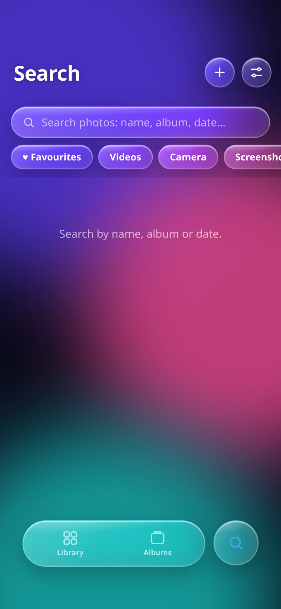

# Liquid Glass Photos

A real, installable Android **photos** app — the liquid-glass UI from the original single-file HTML, wrapped in a native Android shell that reads **your actual phone photo library**. No demo photos, no mock data: on first launch it asks for photo permission and then shows the images that are really on the device. Photos only - video support is deliberately not included.

<p align="center">
  
  
  
</p>
<p align="center">
  
</p>

## Download

**[LiquidGlassPhotos.apk](LiquidGlassPhotos.apk)** — v1.1.2, 110 KB, signed, min Android 7.0 (API 24), target API 34.

Or download it from the [v1.1.2 release](https://github.com/technicalnihilist-lgtm/liquid-glass-photos/releases/latest).

Install it on a phone (enable "install unknown apps" for your file manager), then grant photo access when prompted.

## What works

- **Real gallery** — reads images through Android's `MediaStore`, newest first, grouped by day (Today / Yesterday / date), like Google Photos.
- **Albums** — Recents, Favourites, Camera, Screenshots, Trash, with live counts and cover thumbnails.
- **Viewer** — swipe between items, double-tap to zoom, drag to pan, swipe down to close.
- **Selection** — long-press or tap "Select", then favourite, share or delete a batch. Press one photo and **drag across the grid** to select everything you pass over (drag over selected ones to deselect); it auto-scrolls at the top and bottom edges. **Swipe to the right edge** while dragging and every photo gets selected. The **All** button in the header toggles select-all.
- **Share** — real Android share sheet via `ACTION_SEND_MULTIPLE` with content URIs.
- **Delete** — first moves to the app's Trash (undoable), then "Delete" in Trash calls the Android 11+ system delete confirmation, which removes the file from the device for real.
- **Add** — system image picker; selected photos are copied into your gallery (`Pictures/LiquidGlass`).
- **Depth effect** — the accelerometer drives three parallax layers: the wallpaper moves against the tilt, the photo grid moves a little, and the glass chrome (header buttons, tab bar, selection bar) moves the most and rotates in 3D around the touch point. Tilt the phone and the UI has real depth.
- **4D motion** — when the phone is held still the layers keep drifting on a slow sine, and the glass chrome shimmers gently, so the screen never feels frozen.
- **Liquid glass settings** — transparency, blur, grid size (1–6 columns, also pinch the grid), water sound + volume, bounce, haptics, depth effect, 4D motion, dark/light theme. All persisted.
- **Haptics and sound** — real `VIBRATE` and a Web Audio "plop" on every tap.
- **Back button** — closes the viewer, leaves an album, or exits, in that order.

## How it is built

The UI is the original HTML/CSS/JS, unchanged in look and behaviour. Everything that used to be simulated was replaced with a native bridge:

| Original HTML | This app |
| --- | --- |
| 48 canvas-generated demo photos | `MediaStore` query for real device media |
| `p.src` data URLs | `/thumb/<id>`, `/media/<id>` served by the app |
| fake delete (flag) | app Trash, then Android system delete request |
| `navigator.share` on blobs | native `ACTION_SEND_MULTIPLE` |
| `<input type=file>` | `ACTION_OPEN_DOCUMENT` + copy into MediaStore |
| favourites in memory | `SharedPreferences` |
| (new) tilt parallax | `Sensor.TYPE_ACCELEROMETER` → `window.__native.tilt(x, y)` |

The app is photos-only: only `MediaStore.Images` is queried, and `READ_MEDIA_VIDEO` is not requested in the manifest.

`MainActivity` hosts a `WebView` and serves the app from a private origin (`https://app.local/`) that it intercepts in `shouldInterceptRequest`. That handler does the real work:

- `/thumb/<id>` — decodes a downscaled JPEG with `ImageDecoder` on API 28+ (`BitmapFactory` + `inSampleSize` below that, and as the fallback for anything `ImageDecoder` cannot read), cached in memory, so a 50 MP library scrolls smoothly.
- `/media/<id>` — streams the original image bytes with `Content-Length` and HTTP `Range` / `206 Partial Content` support.

No third-party libraries. No Gradle. No AndroidX. Just the Android framework, one Java file, and the original HTML.

## Performance

The number that matters most on a big library is how long the first tile takes to appear.
`tools/bench_first_frame.js` measures it: it loads the real `app/assets/index.html` in headless
Chromium with the native bridge stubbed, feeds it **2000 photos**, and serves `/thumb/<id>` from a
local HTTP server the same way `shouldInterceptRequest` serves it on the device. Median of 5 runs,
milliseconds from navigation start (412×915 viewport):

| 2000 photos | ms |
| --- | --- |
| chrome painted, empty state | 209 |
| every tile in the DOM | 1705 |
| first thumbnail decoded | 2481 |
| **first tile decoded and painted** | **3657** |

```bash
node tools/bench_first_frame.js --count=2000 --runs=5
```

This is the day-1 baseline (v1.1.0) that the rest of the optimisation plan is measured against. It
is a browser-harness number on a 2-core sandbox, not a phone measurement, so compare pass against
pass rather than against a device. The gap between "first thumbnail decoded" and "first tile
painted" is the cost of laying out the 2000-tile grid, which is where the next passes look first.

## Build it yourself

Requirements: JDK 17, Android SDK platform 34 + build-tools 34.0.0.

```bash
export JAVA_HOME=/path/to/jdk17
export SDK=/path/to/android-sdk
bash build.sh          # aapt2 -> javac -> d8 -> zipalign -> apksigner
```

`build.sh` produces a signed `LiquidGlassPhotos.apk`. The signing key is generated on first run (`lgp-release.jks`) — replace it with your own for a real release.

Icons are generated by `tools/make_icons.py` (Pillow) into `app/res/`, so they are not committed.

## Repo layout

```
app/AndroidManifest.xml                     permissions, activity, theme
app/java/com/liquidglass/photos/MainActivity.java   WebView shell + MediaStore bridge (~900 lines)
app/assets/index.html                       the entire UI (liquid glass)
app/res/                                    strings, colours, theme, adaptive icon
build.sh                                    full APK pipeline without Gradle
tools/make_icons.py                         launcher icon generator
tools/gen_preview.py                        preview harness (see below)
tools/bench_first_frame.js                  first-frame benchmark on a 2000-photo library
docs/screenshots/                           screenshots
```

## About the screenshots

The APK ships with **no** sample media — it is empty until it reads your gallery. The screenshots above were rendered from the same `app/assets/index.html` through `tools/gen_preview.py`, a browser harness that stubs the native bridge with 44 generated sample images. That is the only place sample images exist; they are not in the APK.

## Changelog

### 1.1.2 — day 2 of the 20-day optimisation plan, second pass
No UI change, no new features. Item 12 of the plan: thumbnails decode through `ImageDecoder` on API 28+.
- `ImageDecoder.decodeBitmap` with an `OnHeaderDecodedListener` does the downscale itself:
  `setTargetSize` clamps the longest side to the same 520 px cap the `BitmapFactory` path uses, and
  `setAllocator(SOFTWARE)` + `setMemorySizePolicy(MEMORY_POLICY_LOW_RAM)` keep the result a mutable
  RGB_565 software bitmap, which is what `compress()` needs and the same config as before.
- `BitmapFactory` (with `inSampleSize` and `inDensity`) is now the fallback: every device below API 28,
  and any file `ImageDecoder` throws on, still decodes exactly as it did in 1.1.1.
- Visible effect, and it is a defect fix rather than a redesign: `ImageDecoder` honours the EXIF
  orientation, so a photo shot in portrait no longer shows up sideways in the grid while the viewer
  shows it upright. Nothing else about the tiles changes.

### 1.1.1 — day 2 of the 20-day optimisation plan, first pass
No UI change, no new features. Item 11 of the plan: thumbnails are now scaled inside the decoder.
- `BitmapFactory.Options` gets `inDensity`/`inTargetDensity` set to the post-sample width and the
  520 px cap, so the decoder produces the final size directly instead of allocating a full-size
  bitmap and copying it through `Bitmap.createScaledBitmap`. One fewer large bitmap per thumbnail,
  and the `createScaledBitmap` path is now only a fallback for when the source dimensions are
  unknown. Thumbnail bytes and image quality are unchanged.

### 1.1.0 — day 1 of the 20-day optimisation plan, fourth pass
No UI change, no new features, no app code touched. Item 10 of the plan: the first-frame cost of a
2000-photo library is now measured and written down, so the later passes have a baseline.
- New `tools/bench_first_frame.js`: runs the real `app/assets/index.html` in headless Chromium with
  the bridge stubbed and 2000 photos, serves thumbnails from a local HTTP server, and reports the
  time to the first tile painted (median of runs).
- Result on 2000 photos: first tile decoded and painted at **3657 ms** from navigation start, with
  the empty chrome up at 209 ms and all 2000 tiles in the DOM by 1705 ms. See *Performance* above.

### 1.0.9 — day 1 of the 20-day optimisation plan, third pass
No UI change, no new features.
- The header markup is keyed on mode/tab/album, so toggling a selection during a drag only rewrites
  the title text instead of rebuilding the buttons on every hit-test.

### 1.0.8 — day 1 of the 20-day optimisation plan, second pass
No UI change, no new features.
- The grid is built into a `DocumentFragment` and swapped in with a single insert, instead of assigning a large `innerHTML` string to the live screen.
- When the grid markup has not changed, the screen is left alone: a selection change (select mode, a tap, All) now only flips the `.on` class on the tiles that changed, so the existing `` elements are never recreated or re-decoded.
- Search results get the same treatment: typing a query that resolves to the same list no longer rebuilds the results grid.

### 1.0.7 — day 1 of the 20-day optimisation plan
No UI change, no new features. Only internal work, see `OPTIMIZATION_PLAN.md`.
- Thumbnails decode in **one** pass: the size comes from the MediaStore `WIDTH`/`HEIGHT` columns instead of a second `inJustDecodeBounds` stream open.
- The thumbnail cache is bounded by **bytes** (12 MB LRU) instead of a 220-entry count, so memory stays flat on a big library.
- `.tile` gets `contain: layout paint style`, so off-screen tiles cost nothing to lay out or paint.
- Drag-select hit-tests **once per frame** (rAF) instead of once per pointer event.
- Tilt values are only written to CSS when they actually move (>0.002), cutting style recalcs while the phone is still.
- A 1.5 s cache of the MediaStore result stops a resume + permission callback from querying twice; the cache is invalidated on delete and import.
- One `paintTilt()` per settings change instead of two.

### 1.0.6
- **Drag to select.** In selection mode, press a photo and drag across the grid: every tile you pass is selected (or deselected, if you started on a selected one). The grid auto-scrolls when you drag to the top or bottom edge.
- **Swipe right to select all.** Drag to the right edge of the screen and every photo in the current view is selected at once.
- **All button** in the header while selecting - toggles select-all / clear.
- **Deeper depth + parallax.** The photo plane itself now tilts in perspective with the device (`rotateX`/`rotateY`), the wallpaper parallaxes further against the tilt, and the glass chrome rotates harder - the layers read as separate depths instead of a flat sheet.
- Fixed: the tilt transform was overriding `translateX(-50%)`, which pushed the selection bar and the viewer bar off-centre.

### 1.0.5
- **Depth effect.** A native accelerometer listener (baseline-calibrated, ~30 Hz, paused with the app) feeds tilt into CSS custom properties. Three layers move at different rates - wallpaper against the tilt, grid slightly with it, glass chrome most - and the chrome rotates in 3D (`perspective` + `rotateX/rotateY`), with the tab bar's shadow sliding under it.
- **4D motion.** An idle drift on a slow sine keeps the depth layers alive when the phone is still, plus a gentle shimmer on the glass chrome.
- Both are toggles in the settings sheet, persisted; turning depth off also stops the sensor listener to save battery.
- Soft gradient scrims behind the header and tab bar, so glass labels stay readable over bright photos.
- Tighter settings rows so the whole sheet - including Done/Reset - fits without scrolling.

### 1.0.4
- **Photos only.** Video support removed completely: only `MediaStore.Images` is queried, the `READ_MEDIA_VIDEO` permission is gone, the native video player and the `Videos` album are deleted, and the picker accepts images only.
- Smaller APK and a shorter permission list - the app asks for photo access only.

### 1.0.3
- **Full-screen video with no black bars.** The player now measures the surface to the centre-cropped video size and tells the decoder to scale-to-fit-with-cropping, so 16:9, 4:3, vertical and square clips all fill the display edge-to-edge instead of being letterboxed.
- The playback scrubber is anchored to the window rather than the video surface, so it stays correctly placed at the bottom of the screen.

### 1.0.2
- **Fixed: videos would not play.** WebView never fetched `<video>` sources through the app's request interceptor, so playback now happens in a native full-screen player (`VideoView` + `MediaController`) with seek, pause/resume and an automatic fallback to the phone's own player.
- Video tiles in the grid open straight into the player; inside the viewer a video shows its poster frame with a play button.

### 1.0.1
- Returning to the app now refreshes the library, so photos taken in another app show up (throttled so it does not re-query on every resume).
- Opening the keyboard scrolls the search field into view instead of leaving it hidden behind it.
- Media streams release their file descriptors reliably.

### 1.0.0
- First release: native MediaStore gallery, albums, viewer with zoom, selection, share, trash + system delete, picker import, liquid-glass settings.

## Licence

MIT. The original single-file HTML design belongs to whoever made it.

---

## ⭐ Like this work? Give it a star

If you like this app and our work, please **star this repository** ⭐ and **[follow technicalnihilist-lgtm on GitHub](https://github.com/technicalnihilist-lgtm)**. If our work isn't for you, that's completely fine — the choice is yours. Thank you for stopping by!

<details>
<summary><b>🌍 Same message in 32 languages (A–Z + Indian languages)</b></summary>

- **A — Arabic** (العربية): ⭐ إذا أعجبك هذا التطبيق وعملنا، فيرجى منح المستودع نجمة ومتابعتنا. وإذا لم يعجبك عملنا، فلا مشكلة على الإطلاق — القرار قرارك. شكرًا لزيارتك!
- **B — Bengali** (বাংলা): ⭐ যদি আপনার এই অ্যাপ এবং আমাদের কাজ ভালো লাগে, তবে অনুগ্রহ করে রিপোজিটরিটিকে একটি স্টার দিন এবং আমাদের ফলো করুন। আমাদের কাজ যদি আপনার পছন্দ না হয়, তাতেও কোনো সমস্যা নেই — সিদ্ধান্ত আপনার। আমাদের পেজে আসার জন্য ধন্যবাদ!
- **C — Chinese** (中文): ⭐ 如果你喜欢这个应用和我们的作品，请给仓库点个星标并关注我们。如果我们的作品不适合你，也完全没关系——选择权在你。感谢你的到访！
- **D — Dutch** (Nederlands): ⭐ Vind je deze app en ons werk leuk? Geef de repository dan een ster en volg ons. Vind je ons werk niets, dan is dat helemaal prima — de keuze is aan jou. Bedankt voor je bezoek!
- **E — English** (English): ⭐ If you like this app and our work, please give the repository a star and follow us. If our work isn't for you, that's completely fine — the choice is yours. Thank you for stopping by!
- **F — French** (Français): ⭐ Si cette application et notre travail vous plaisent, mettez une étoile au dépôt et suivez-nous. Si notre travail n'est pas pour vous, aucun souci — c'est votre choix. Merci de votre visite !
- **G — German** (Deutsch): ⭐ Wenn dir diese App und unsere Arbeit gefallen, gib dem Repository einen Stern und folge uns. Wenn unsere Arbeit nichts für dich ist, ist das völlig in Ordnung — die Wahl liegt bei dir. Danke fürs Vorbeischauen!
- **H — Hindi** (हिन्दी): ⭐ अगर आपको यह ऐप और हमारा काम पसंद है, तो कृपया रिपॉजिटरी को स्टार दें और हमें फॉलो करें। अगर हमारा काम आपके लिए नहीं है, तो भी कोई बात नहीं — यह पूरी तरह आपकी मर्ज़ी है। यहाँ आने के लिए आपका धन्यवाद!
- **I — Indonesian** (Bahasa Indonesia): ⭐ Jika kamu suka aplikasi ini dan karya kami, beri bintang pada repositori ini dan ikuti kami. Kalau karya kami bukan untukmu, tidak masalah sama sekali — itu pilihanmu. Terima kasih sudah mampir!
- **J — Japanese** (日本語): ⭐ このアプリと私たちの仕事が気に入ったら、リポジトリにスターを付けてフォローしてください。合わない場合はまったく問題ありません — 選ぶのはあなたです。お越しいただきありがとうございます！
- **K — Korean** (한국어): ⭐ 이 앱과 저희 작업이 마음에 드신다면 저장소에 스타를 눌러 주시고 팔로우해 주세요. 저희 작업이 맞지 않으셔도 전혀 괜찮습니다 — 선택은 여러분의 몫입니다. 방문해 주셔서 감사합니다!
- **L — Lithuanian** (Lietuvių): ⭐ Jei tau patinka ši programa ir mūsų darbas, duok saugyklai žvaigždutę ir sek mus. Jei mūsų darbas ne tau, viskas gerai — pasirinkimas tavo. Ačiū, kad užsukai!
- **M — Malayalam** (മലയാളം): ⭐ നിങ്ങൾക്ക് ഈ ആപ്പും ഞങ്ങളുടെ പ്രവർത്തനവും ഇഷ്ടപ്പെട്ടെങ്കിൽ, ദയവായി റെപ്പോസിറ്ററിക്ക് ഒരു സ്റ്റാർ നൽകുകയും ഞങ്ങളെ ഫോളോ ചെയ്യുകയും ചെയ്യുക. ഞങ്ങളുടെ പ്രവർത്തനം നിങ്ങൾക്ക് അനുയോജ്യമല്ലെങ്കിൽ, അതും തികച്ചും കുഴപ്പമില്ല — തീരുമാനം നിങ്ങളുടേതാണ്. ഇവിടെ വന്നതിന് നന്ദി!
- **N — Nepali** (नेपाली): ⭐ यदि तपाईंलाई यो एप र हाम्रो काम मन पर्‍यो भने, कृपया रिपोजिटरीलाई स्टार दिनुहोस् र हामीलाई फलो गर्नुहोस्। यदि हाम्रो काम तपाईंलाई मन पर्दैन भने, पनि ठीकै छ — यो तपाईंको इच्छा हो। यहाँ आउनुभएकोमा धन्यवाद!
- **O — Odia** (ଓଡ଼ିଆ): ⭐ ଯଦି ଆପଣଙ୍କୁ ଏହି ଆପ୍ ଏବଂ ଆମର କାମ ଭଲ ଲାଗୁଛି, ତେବେ ଦୟାକରି ରିପୋଜିଟୋରୀକୁ ଗୋଟିଏ ଷ୍ଟାର୍ ଦିଅନ୍ତୁ ଏବଂ ଆମକୁ ଫଲୋ କରନ୍ତୁ। ଯଦି ଆମର କାମ ଆପଣଙ୍କ ପାଇଁ ନୁହେଁ, ତେବେ କିଛି ଅସୁବିଧା ନାହିଁ — ପସନ୍ଦ ଆପଣଙ୍କର। ଆମ ପାଖକୁ ଆସିଥିବାରୁ ଧନ୍ୟବାଦ!
- **P — Polish** (Polski): ⭐ Jeśli podoba Ci się ta aplikacja i nasza praca, daj repozytorium gwiazdkę i obserwuj nas. Jeśli nasza praca nie jest dla Ciebie, to zupełnie w porządku — wybór należy do Ciebie. Dziękujemy za odwiedziny!
- **Q — Quechua** (Runa Simi): ⭐ Kay app, ñuqaykup ruwasqanchikpas gustasunki chayqa, repositorioman huk estrella churay, ñuqaykutapas qatipayku. Mana gustasunki chayqa, allinmi — qampa akllayki. Hamusqaykimanta sulpayki!
- **R — Russian** (Русский): ⭐ Если вам нравится это приложение и наша работа, поставьте звёздочку репозиторию и подпишитесь на нас. Если наша работа не для вас — это совершенно нормально, выбор за вами. Спасибо, что заглянули!
- **S — Spanish** (Español): ⭐ Si te gusta esta app y nuestro trabajo, dale una estrella al repositorio y síguenos. Si nuestro trabajo no es para ti, no pasa nada — la decisión es tuya. ¡Gracias por pasarte!
- **T — Tamil** (தமிழ்): ⭐ உங்களுக்கு இந்த ஆப்பும் எங்க வேலையும் பிடிச்சிருந்தா, தயவுசெஞ்சு இந்த ரெபாசிட்டரிக்கு ஒரு ஸ்டார் குடுத்து, எங்களை ஃபாலோ பண்ணுங்க. எங்க வேலை உங்களுக்கு செட் ஆகலைன்னாலும் பரவாயில்லை — அது உங்க விருப்பம். இங்கே வந்ததுக்கு நன்றி!
- **U — Urdu** (اردو): ⭐ اگر آپ کو یہ ایپ اور ہمارا کام پسند آئے تو براہ کرم ریپازٹری کو سٹار دیں اور ہمیں فالو کریں۔ اگر ہمارا کام آپ کے لیے نہیں ہے، تو یہ بالکل ٹھیک ہے — انتخاب آپ کا ہے۔ یہاں تشریف لانے کا شکریہ!
- **V — Vietnamese** (Tiếng Việt): ⭐ Nếu bạn thích ứng dụng này và công việc của chúng tôi, hãy tặng kho lưu trữ một ngôi sao và theo dõi chúng tôi. Nếu công việc của chúng tôi không phù hợp với bạn, điều đó hoàn toàn ổn — lựa chọn là của bạn. Cảm ơn bạn đã ghé qua!
- **W — Welsh** (Cymraeg): ⭐ Os ydych chi'n hoffi'r ap hwn a'n gwaith, rhowch seren i'r storfa a dilynwch ni. Os nad yw ein gwaith ar eich cyfer, mae hynny'n hollol iawn — chi sydd i benderfynu. Diolch am alw heibio!
- **X — Xhosa** (isiXhosa): ⭐ Ukuba uyayithanda le app nomsebenzi wethu, nika irepo inkwenkwezi kwaye usilandele. Ukuba umsebenzi wethu awukufanelanga, akukho ngxaki — lukhetho lwakho. Enkosi ngokutyelela!
- **Y — Yoruba** (Yorùbá): ⭐ Bí app yìí àti iṣẹ́ wa bá wù ọ́, jọ̀wọ́ fún àkójọpọ̀ náà ní ìràwọ̀ kí o sì tẹ̀lé wa. Bí iṣẹ́ wa kò bá yẹ ọ́, kò séwu — ìwọ ni ó yàn. Ẹ ṣé fún wíwá!
- **Z — Zulu** (isiZulu): ⭐ Uma uthanda le app nomsebenzi wethu, nikeza isitoreji inkanyezi bese usilandela. Uma umsebenzi wethu ungakufanele, akunankinga — wukukhetha kwakho. Siyabonga ngokuvakasha!

**More Indian languages**

- **Assamese** (অসমীয়া): ⭐ যদি আপুনি এই এপটো আৰু আমাৰ কাম ভাল পায়, তেন্তে অনুগ্ৰহ কৰি ৰিপজিটৰীটোক এটা ষ্টাৰ দিয়ক আৰু আমাক ফ'ল' কৰক। যদি আমাৰ কাম আপোনাৰ বাবে নহয়, তেন্তে সেয়া একেবাৰে ঠিক আছে — সিদ্ধান্তটো আপোনাৰ। আমাৰ ইয়ালৈ অহাৰ বাবে ধন্যবাদ!
- **Gujarati** (ગુજરાતી): ⭐ જો તમને આ એપ અને અમારું કામ ગમતું હોય, તો પ્લીઝ રિપોઝિટરીને સ્ટાર આપો અને અમને ફોલો કરો. જો અમારું કામ તમને ન ગમતું હોય, તો તે પણ બરાબર છે — પસંદગી તમારી છે. અહીં આવવા બદલ આભાર!
- **Kannada** (ಕನ್ನಡ): ⭐ ನಿಮಗೆ ಈ ಆ್ಯಪ್ ಮತ್ತು ನಮ್ಮ ಕೆಲಸ ಇಷ್ಟವಾದರೆ, ದಯವಿಟ್ಟು ರೆಪೊಸಿಟರಿಗೆ ಸ್ಟಾರ್ ಕೊಡಿ ಮತ್ತು ನಮ್ಮನ್ನು ಫಾಲೋ ಮಾಡಿ. ನಮ್ಮ ಕೆಲಸ ನಿಮಗೆ ಸರಿಹೊಂದದಿದ್ದರೆ, ಅದೂ ಪರವಾಗಿಲ್ಲ — ಆಯ್ಕೆ ನಿಮ್ಮದು. ಭೇಟಿ ನೀಡಿದ್ದಕ್ಕೆ ಧನ್ಯವಾದಗಳು!
- **Marathi** (मराठी): ⭐ जर तुम्हाला हे ॲप आणि आमचं काम आवडलं असेल, तर कृपया रिपॉझिटरीला स्टार द्या आणि आम्हाला फॉलो करा. जर आमचं काम तुम्हाला आवडत नसेल, तर काही हरकत नाही — ती तुमची निवड आहे. इथे आल्याबद्दल धन्यवाद!
- **Punjabi** (ਪੰਜਾਬੀ): ⭐ ਜੇ ਤੁਹਾਨੂੰ ਇਹ ਐਪ ਅਤੇ ਸਾਡਾ ਕੰਮ ਪਸੰਦ ਹੈ, ਤਾਂ ਕਿਰਪਾ ਕਰਕੇ ਰਿਪੋਜ਼ਟਰੀ ਨੂੰ ਸਟਾਰ ਦਿਓ ਅਤੇ ਸਾਨੂੰ ਫਾਲੋ ਕਰੋ। ਜੇ ਸਾਡਾ ਕੰਮ ਤੁਹਾਡੇ ਲਈ ਨਹੀਂ ਹੈ, ਤਾਂ ਕੋਈ ਗੱਲ ਨਹੀਂ — ਚੋਣ ਤੁਹਾਡੀ ਹੈ। ਸਾਡੇ ਪੇਜ 'ਤੇ ਆਉਣ ਲਈ ਧੰਨਵਾਦ!
- **Telugu** (తెలుగు): ⭐ మీకు ఈ యాప్, మా పని నచ్చితే, దయచేసి రిపోజిటరీకి ఒక స్టార్ ఇచ్చి మమ్మల్ని ఫాలో అవ్వండి. ఒకవేళ మా పని మీకు నచ్చకపోతే, పర్వాలేదు — అది మీ ఇష్టం. మమ్మల్ని సందర్శించినందుకు ధన్యవాదాలు!

</details>
