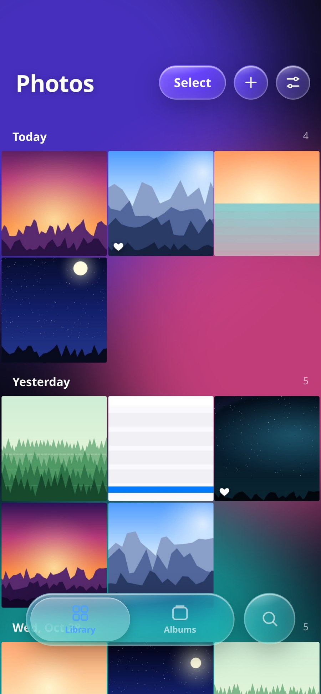
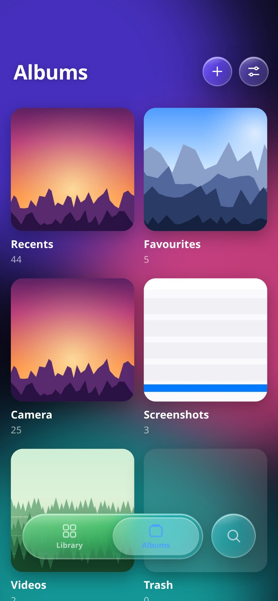
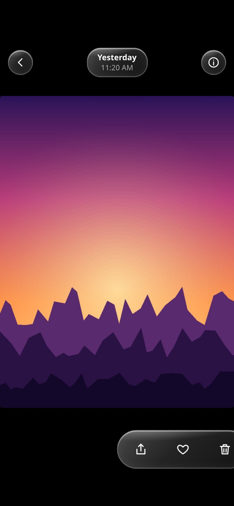

# Liquid Glass Photos

A real, installable Android gallery app — the liquid-glass UI from the original single-file HTML, wrapped in a native Android shell that reads **your actual phone gallery**. No demo photos, no mock data: on first launch it asks for photo permission and then shows the images and videos that are really on the device.

<p align="center">
  
  
  
</p>

## Download

**[LiquidGlassPhotos.apk](LiquidGlassPhotos.apk)** — v1.0.1, 106 KB, signed, min Android 7.0 (API 24), target API 34.

Or download it from the [v1.0.1 release](https://github.com/technicalnihilist-lgtm/liquid-glass-photos/releases/latest).

Install it on a phone (enable "install unknown apps" for your file manager), then grant photo access when prompted.

## What works

- **Real gallery** — reads images and videos through Android's `MediaStore`, newest first, grouped by day (Today / Yesterday / date), like Google Photos.
- **Albums** — Recents, Favourites, Camera, Screenshots, Videos, Trash, with live counts and cover thumbnails.
- **Viewer** — swipe between items, double-tap to zoom, drag to pan, swipe down to close, video playback with seek.
- **Selection** — long-press or "Select", then favourite, share, or delete a batch.
- **Share** — real Android share sheet via `ACTION_SEND_MULTIPLE` with content URIs.
- **Delete** — first moves to the app's Trash (undoable), then "Delete" in Trash calls the Android 11+ system delete confirmation, which removes the file from the device for real.
- **Add** — system file picker; selected images/videos are copied into your gallery (`Pictures/LiquidGlass`).
- **Liquid glass settings** — transparency, blur, grid size (1–6 columns, also pinch the grid), water sound + volume, bounce, haptics, dark/light theme. All persisted.
- **Haptics and sound** — real `VIBRATE` and a Web Audio "plop" on every tap.
- **Back button** — closes the viewer, leaves an album, or exits, in that order.

## How it is built

The UI is the original HTML/CSS/JS, unchanged in look and behaviour. Everything that used to be simulated was replaced with a native bridge:

| Original HTML | This app |
| --- | --- |
| 48 canvas-generated demo photos | `MediaStore` query for real device media |
| `p.src` data URLs | `/thumb/i/<id>`, `/media/v/<id>` served by the app |
| fake delete (flag) | app Trash, then Android system delete request |
| `navigator.share` on blobs | native `ACTION_SEND_MULTIPLE` |
| `<input type=file>` | `ACTION_OPEN_DOCUMENT` + copy into MediaStore |
| favourites in memory | `SharedPreferences` |

`MainActivity` hosts a `WebView` and serves the app from a private origin (`https://app.local/`) that it intercepts in `shouldInterceptRequest`. That handler does the real work:

- `/thumb/i/<id>` and `/thumb/v/<id>` — decodes a downscaled JPEG (images via `BitmapFactory` with `inSampleSize`, videos via `MediaMetadataRetriever`), cached in memory, so a 50 MP library scrolls smoothly.
- `/media/i/<id>` and `/media/v/<id>` — streams the original bytes with `Content-Length` and full HTTP `Range` / `206 Partial Content` support, which is what makes video seeking work.

No third-party libraries. No Gradle. No AndroidX. Just the Android framework, one Java file, and the original HTML.

## Build it yourself

Requirements: JDK 17, Android SDK platform 34 + build-tools 34.0.0.

```bash
export JAVA_HOME=/path/to/jdk17
export SDK=/path/to/android-sdk
bash build.sh          # aapt2 -> javac -> d8 -> zipalign -> apksigner
```

`build.sh` produces a signed `LiquidGlassPhotos.apk`. The signing key is generated on first run (`lgp-release.jks`) — replace it with your own for a real release.

Icons are generated by `tools/make_icons.py` (Pillow) into `app/res/`, so they are not committed.

## Repo layout

```
app/AndroidManifest.xml                     permissions, activity, theme
app/java/com/liquidglass/photos/MainActivity.java   WebView shell + MediaStore bridge (~900 lines)
app/assets/index.html                       the entire UI (liquid glass)
app/res/                                    strings, colours, theme, adaptive icon
build.sh                                    full APK pipeline without Gradle
tools/make_icons.py                         launcher icon generator
tools/gen_preview.py                        preview harness (see below)
docs/screenshots/                           screenshots
```

## About the screenshots

The APK ships with **no** sample media — it is empty until it reads your gallery. The screenshots above were rendered from the same `app/assets/index.html` through `tools/gen_preview.py`, a browser harness that stubs the native bridge with 44 generated sample images. That is the only place sample images exist; they are not in the APK.

## Changelog

### 1.0.1
- Returning to the app now refreshes the library, so photos taken in another app show up (throttled so it does not re-query on every resume).
- Opening the keyboard scrolls the search field into view instead of leaving it hidden behind it.
- Media streams release their file descriptors reliably.

### 1.0.0
- First release: native MediaStore gallery, albums, viewer with zoom, selection, share, trash + system delete, picker import, liquid-glass settings.

## Licence

MIT. The original single-file HTML design belongs to whoever made it.
