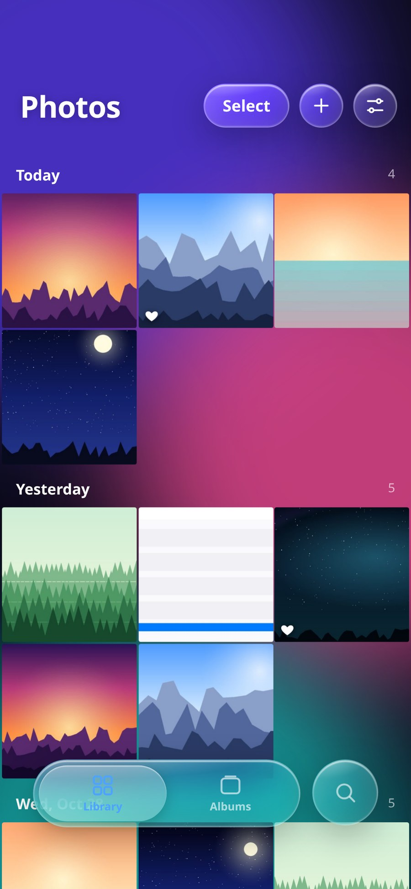
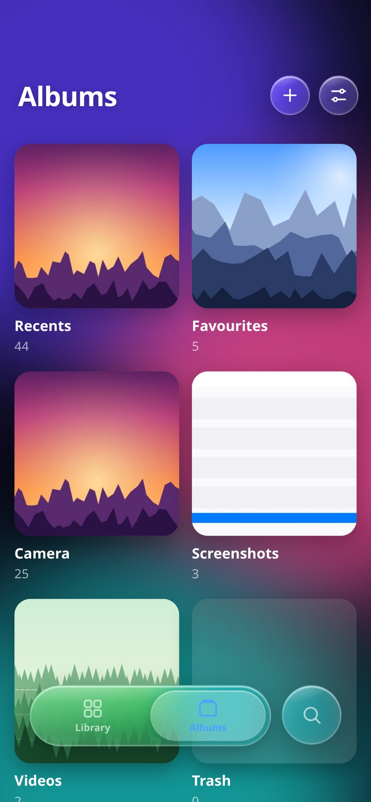
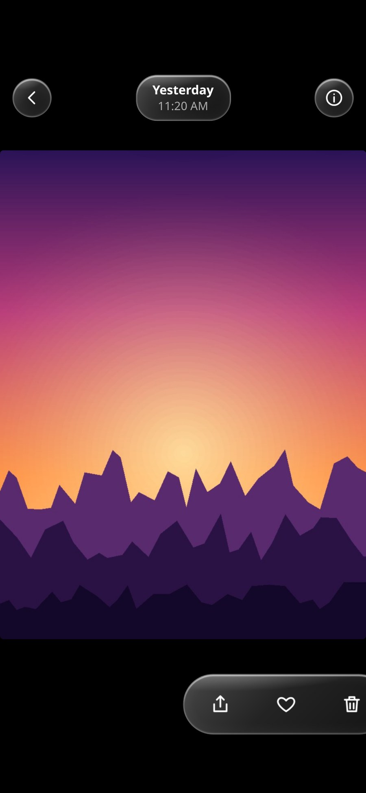
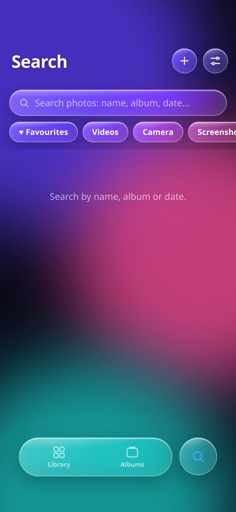

# Liquid Glass Photos

A real, installable Android **photos** app — the liquid-glass UI from the original single-file HTML, wrapped in a native Android shell that reads **your actual phone photo library**. No demo photos, no mock data: on first launch it asks for photo permission and then shows the images that are really on the device. Photos only - video support is deliberately not included.

<p align="center">
  
  
  
</p>
<p align="center">
  
</p>

## Download

**[LiquidGlassPhotos.apk](LiquidGlassPhotos.apk)** — v1.3.2, 114 KB, signed, min Android 7.0 (API 24), target API 34.

Or download it from the [v1.3.2 release](https://github.com/technicalnihilist-lgtm/liquid-glass-photos/releases/latest).

Install it on a phone (enable "install unknown apps" for your file manager), then grant photo access when prompted.

## What works

- **Real gallery** — reads images through Android's `MediaStore`, newest first, grouped by day (Today / Yesterday / date), like Google Photos.
- **Albums** — Recents, Favourites, Camera, Screenshots, Trash, with live counts and cover thumbnails.
- **Viewer** — swipe between items, double-tap to zoom, drag to pan, swipe down to close.
- **Selection** — long-press or tap "Select", then favourite, share or delete a batch. Press one photo and **drag across the grid** to select everything you pass over (drag over selected ones to deselect); it auto-scrolls at the top and bottom edges. **Swipe to the right edge** while dragging and every photo gets selected. The **All** button in the header toggles select-all.
- **Share** — real Android share sheet via `ACTION_SEND_MULTIPLE` with content URIs.
- **Delete** — first moves to the app's Trash (undoable), then "Delete" in Trash calls the Android 11+ system delete confirmation, which removes the file from the device for real.
- **Add** — system image picker; selected photos are copied into your gallery (`Pictures/LiquidGlass`).
- **Depth effect** — the accelerometer drives three parallax layers: the wallpaper moves against the tilt, the photo grid moves a little, and the glass chrome (header buttons, tab bar, selection bar) moves the most and rotates in 3D around the touch point. Tilt the phone and the UI has real depth.
- **4D motion** — when the phone is held still the layers keep drifting on a slow sine, and the glass chrome shimmers gently, so the screen never feels frozen.
- **Liquid glass settings** — transparency, blur, grid size (1–6 columns, also pinch the grid), water sound + volume, bounce, haptics, depth effect, 4D motion, dark/light theme. All persisted.
- **Haptics and sound** — real `VIBRATE` and a Web Audio "plop" on every tap.
- **Back button** — closes the viewer, leaves an album, or exits, in that order.

## How it is built

The UI is the original HTML/CSS/JS, unchanged in look and behaviour. Everything that used to be simulated was replaced with a native bridge:

| Original HTML | This app |
| --- | --- |
| 48 canvas-generated demo photos | `MediaStore` query for real device media |
| `p.src` data URLs | `/thumb/<id>`, `/media/<id>` served by the app |
| fake delete (flag) | app Trash, then Android system delete request |
| `navigator.share` on blobs | native `ACTION_SEND_MULTIPLE` |
| `<input type=file>` | `ACTION_OPEN_DOCUMENT` + copy into MediaStore |
| favourites in memory | `SharedPreferences` |
| (new) tilt parallax | `Sensor.TYPE_ACCELEROMETER` → `window.__native.tilt(x, y)` |

The app is photos-only: only `MediaStore.Images` is queried, and `READ_MEDIA_VIDEO` is not requested in the manifest.

`MainActivity` hosts a `WebView` and serves the app from a private origin (`https://app.local/`) that it intercepts in `shouldInterceptRequest`. That handler does the real work:

- `/thumb/<id>` — decodes a downscaled JPEG with `ImageDecoder` on API 28+ (`BitmapFactory` + `inSampleSize` below that, and as the fallback for anything `ImageDecoder` cannot read), cached in memory, so a 50 MP library scrolls smoothly.
- `/media/<id>` — streams the original image bytes with `Content-Length` and HTTP `Range` / `206 Partial Content` support.

No third-party libraries. No Gradle. No AndroidX. Just the Android framework, one Java file, and the original HTML.

## Performance

The number that matters most on a big library is how long the first tile takes to appear.
`tools/bench_first_frame.js` measures it: it loads the real `app/assets/index.html` in headless
Chromium with the native bridge stubbed, feeds it **2000 photos**, and serves `/thumb/<id>` from a
local HTTP server the same way `shouldInterceptRequest` serves it on the device. Median of 5 runs,
milliseconds from navigation start (412×915 viewport):

| 2000 photos | ms |
| --- | --- |
| chrome painted, empty state | 209 |
| every tile in the DOM | 1705 |
| first thumbnail decoded | 2481 |
| **first tile decoded and painted** | **3657** |

```bash
node tools/bench_first_frame.js --count=2000 --runs=5
```

This is the day-1 baseline (v1.1.0) that the rest of the optimisation plan is measured against. It
is a browser-harness number on a 2-core sandbox, not a phone measurement, so compare pass against
pass rather than against a device. The gap between "first thumbnail decoded" and "first tile
painted" is the cost of laying out the 2000-tile grid, which is where the next passes look first.

## Build it yourself

Requirements: JDK 17, Android SDK platform 34 + build-tools 34.0.0.

```bash
export JAVA_HOME=/path/to/jdk17
export SDK=/path/to/android-sdk
bash build.sh          # aapt2 -> javac -> d8 -> zipalign -> apksigner
```

`build.sh` produces a signed `LiquidGlassPhotos.apk`. The signing key is generated on first run (`lgp-release.jks`) — replace it with your own for a real release.

Icons are generated by `tools/make_icons.py` (Pillow) into `app/res/`, so they are not committed.

## Repo layout

```
app/AndroidManifest.xml                     permissions, activity, theme
app/java/com/liquidglass/photos/MainActivity.java   WebView shell + MediaStore bridge (~900 lines)
app/assets/index.html                       the entire UI (liquid glass)
app/res/                                    strings, colours, theme, adaptive icon
build.sh                                    full APK pipeline without Gradle
tools/make_icons.py                         launcher icon generator
tools/gen_preview.py                        preview harness (see below)
tools/bench_first_frame.js                  first-frame benchmark on a 2000-photo library
docs/screenshots/                           screenshots
```

## About the screenshots

The APK ships with **no** sample media — it is empty until it reads your gallery. The screenshots above were rendered from the same `app/assets/index.html` through `tools/gen_preview.py`, a browser harness that stubs the native bridge with 44 generated sample images. That is the only place sample images exist; they are not in the APK.

## Changelog

### 1.3.2 — day 4 of the 20-day optimisation plan, fourteenth pass
No UI change, no new features. Item 32 of the plan: a `shouldInterceptRequest` fast path for
`favicon.ico`.
- Chromium requests `/favicon.ico` on the first paint, and the app ships no icon. The request
  missed the asset table, so it fell through to the `index.html` fallback: the whole app was
  opened from the APK, streamed back and discarded as an icon — on every launch and every reload.
- That path is now answered `204 No Content` before any asset lookup, with no body and no content
  type, which is the answer a browser already gives for a site with no icon.
- The header pair never varies, so the 204 reuses one unmodifiable `NO_CONTENT_HEADERS` map built
  at class load (`Cache-Control: no-store`, `Content-Length: 0`) instead of allocating one per
  request; `no-store` keeps the absence from being cached as if it were a file.
- Nothing else changed: every other path, status code, header value and body is untouched, and no
  screen, control or gesture moved.
- `tools/test_suite.js` gains a check that the favicon branch sits before `asset()`, that the 204
  keeps its shared map and that the map is not allocated per request.
- 30 checks in `tools/test_suite.js`, all PASS; `tools/test_ui.js` all PASS.

### 1.3.1 — day 4 of the 20-day optimisation plan, thirteenth pass
No UI change, no new features. Item 31 of the plan: reuse a single `WebResourceResponse`
header map where safe.
- Every response used to build its own `HashMap` and put the same two or three constant headers
  into it, on the request thread, once per request: a launch paid that for `index.html`, and
  again for every miss that fell through to the 404. Those shapes now share one map, built once
  at class load.
- A shared map is only safe because nothing can write to it afterwards, so each one is wrapped
  in `Collections.unmodifiableMap` before it is published: the WebView reads headers off the UI
  thread while the response streams. The 404 keeps its `no-store` / `Content-Length: 0` pair,
  assets keep `Content-Type: <mime>; charset=utf-8` / `no-cache`, and media keeps
  `Accept-Ranges` / `Content-Type` / `Cache-Control`.
- The responses whose headers depend on the request still build their own map — a thumb's
  `Content-Length`, a media range's `Content-Range` and `Content-Length` — because reusing a
  mutable map there would race the reader.
- Every header value, status code and body is unchanged; `tools/test_suite.js` gains a check
  that the fixed shapes carry no per-request `HashMap` and that the shared maps are unmodifiable.
- 29 checks in `tools/test_suite.js`, all PASS; `tools/test_ui.js` all PASS.

### 1.3.0 — day 4 of the 20-day optimisation plan, twelfth pass
No UI change, no new features. Item 30 of the plan: log the query duration behind
`Log.isLoggable(DEBUG)`.
- The MediaStore scan is the one part of the first frame that was never measured, which makes a
  slow cold start ambiguous: it could be the provider walking a 6000-row library, or the decode
  path behind it. `queryMedia()` now reads `Log.isLoggable(TAG, Log.DEBUG)` once and, only when
  debug logging is on, takes a `System.nanoTime()` before `queryOne()` and prints a single
  `Log.d` line — `query 1234 rows in 87 ms` — after the sort.
- The guard is the whole point: a normal run does one boolean read, no clock call, no string
  concatenation and no log line, and the query, its projection, its paging and its order are
  byte-for-byte unchanged. Turn it on with
  `adb shell setprop log.tag.LGP DEBUG`.
- `tools/test_suite.js` gains a check that the clock read and the log line both sit inside the
  guard and that no second unguarded `Log.d` exists anywhere in the bridge (28 checks now).
- 28 checks in `tools/test_suite.js`, all PASS; `tools/test_ui.js` all PASS.

### 1.2.8 — day 3 of the 20-day optimisation plan, eleventh pass
No UI change, no new features. Item 28 of the plan: close cursors in a `finally` on every path.
- The library query holds one `Cursor` per page, and a leaked one leaks a `CursorWindow` and a
  provider-side file descriptor with it. The audit walked every exit from the page: the provider
  handing back a null cursor, a row that throws mid-read, a `getColumnIndexOrThrow` failing after
  the window is open, and the plain early return at the end of the page. All of them unwind through
  the same `finally`, which sits outside the `try` and therefore sees the cursor whichever way the
  page ends.
- The close itself is now guarded: a provider that throws out of `close()` used to escape the
  `finally` and turn a page that had already been read into a failed query, so the close is wrapped
  and its failure dropped, the way the other stream closes in the bridge already are.
- `tools/test_suite.js` gains a check that pins the shape: exactly one `Cursor` in the file, declared
  before the `try`; every `query()` call inside that one method; the row loop inside the `try`; and
  no `close()` anywhere outside a `finally` (26 checks now).
- 26 checks in `tools/test_suite.js`, all PASS; `tools/test_ui.js` all PASS.

### 1.2.7 — day 3 of the 20-day optimisation plan, tenth pass
No UI change, no new features. Item 27 of the plan: handle a null `BUCKET_DISPLAY_NAME` without
allocating a string per row.
- `BUCKET_DISPLAY_NAME` is null on rows the provider has no album for, and the provider hands back
  a freshly allocated `String` for every other row even when a thousand of them name the same
  album. A 6000-row library therefore held up to 6000 bucket strings, all of them duplicates, all
  of them live for as long as the grid is.
- Rows with no bucket now point at one shared `EMPTY` constant instead of building a literal, and
  every repeated album name is pooled on the first instance seen in that query, so the same album
  is one string no matter how many photos it holds. The pool lives for one query and is dropped
  with the cursor.
- The value each row carries is unchanged — `""` for a row with no album, the album name otherwise
  — so the album filters, the camera/screenshot tests, the search haystack and the detail sheet read
  exactly what they read before.
- `tools/test_suite.js` gains a check that pins the shared constant, the pooling and the absence of
  a per-row string build in the row loop (25 checks now).
- 25 checks in `tools/test_suite.js`, all PASS.

### 1.2.6 — day 3 of the 20-day optimisation plan, ninth pass
No UI change, no new features. Item 26 of the plan: sort by `DATE_TAKEN` when available,
`DATE_MODIFIED` otherwise.
- The library was ordered by `DATE_MODIFIED`, which is the file's timestamp, not the moment the
  photo was taken. Any file that had been touched — edited, re-saved, restored from a backup,
  copied off a card — carried a fresh modification time and jumped to the top of the grid, and its
  day header said "Today" for a picture from 2019.
- `DATE_TAKEN` is now projected alongside `DATE_MODIFIED` and read once per row, and it wins
  whenever it is non-zero. Rows with no capture time (screenshots, downloads, imported files, older
  media) fall back to `DATE_MODIFIED` exactly as before, so no photo loses a date and the order
  stays total. Both columns are milliseconds once normalised: `DATE_TAKEN` already is,
  `DATE_MODIFIED` is multiplied by 1000 as it always was.
- The provider sort string is deliberately left as `DATE_MODIFIED DESC`. That column is never null
  and the provider only accepts plain column names in a sort order, so paging and the 6000-row
  ceiling still return exactly the rows they returned before — the capture date only reorders what
  came back, in the comparator that already sorted on the effective date.
- The on-disk thumbnail stays keyed on `DATE_MODIFIED` (kept in its own `modified` field), so an
  edit still invalidates the cached thumb even though the capture date does not move.
- `tools/test_suite.js` gains a check that pins the projection, the millisecond handling, the
  fallback expression, the `modified`-keyed thumb stamp and the untouched provider sort (24 checks
  now).
- 24 checks in `tools/test_suite.js`, all PASS; `tools/test_ui.js` PASS on 240 photos.

### 1.2.5 — day 3 of the 20-day optimisation plan, eighth pass
No UI change, no new features. Item 25 of the plan: skip pending (`IS_PENDING=1`) media so a
half-written import never appears.
- The importer writes a MediaStore row with `IS_PENDING = 1`, copies the bytes, then clears the
  flag. Until it does, the provider happily returns that row to a query, so a photo still being
  written showed up in the grid as a blank or half-drawn tile, and its `/thumb/` request answered
  404 because the file was not complete yet.
- The page query now carries `is_pending = 0` on API 29+, where the column exists, ANDed onto the
  existing `is_trashed = 0` term on API 30+. The provider filters both before the `LIMIT`/`OFFSET`,
  so a page still returns 1000 usable rows and the 6000-row ceiling still counts real photos. The
  projection, the sort and the row loop are untouched, and the pending row appears on the next
  query once the import finishes.
- Below API 29 there is no `IS_PENDING` column, so the selection is exactly what it was.
- `tools/test_suite.js` gains a check that pins the selection order (`is_trashed = 0 AND
  is_pending = 0`), the API gates and the fact that the pending term never leaks into the row loop
  (23 checks now).
- 23 checks in `tools/test_suite.js`, all PASS; `tools/test_ui.js` PASS on 240 photos.

### 1.2.4 — day 3 of the 20-day optimisation plan, seventh pass
No UI change, no new features. Item 24 of the plan: skip trashed media through the `IS_TRASHED`
column on API 30+.
- Android 11 added a recycle bin. A photo the user sends to the bin keeps its MediaStore row until
  the bin is emptied, and that row was still being returned by the library query, so deleted
  pictures sat in the grid. Each page query now carries a `QUERY_ARG_SQL_SELECTION` term of
  `is_trashed = 0` on API 30+, which the provider applies before the `LIMIT`/`OFFSET`, so the
  paging still returns 1000 usable rows per page and the 6000-row ceiling now counts real photos
  instead of tombstones.
- The filter costs nothing per row here: the provider drops the trashed rows while building the
  cursor, so no extra column is projected and the row loop is untouched. Below API 30 there is no
  `IS_TRASHED` column and no recycle bin, so the query is byte-for-byte what it was.
- Fixed the last flaky check in the suite: "every thumb response sends Content-Length" counted the
  responses as soon as the tiles were laid out, while their images were still in flight, so a fast
  machine measured 0/0 and failed. It now waits for the first `/thumb/` response before counting
  (60/60 on every run).
- 22 checks in `tools/test_suite.js`, all PASS; `tools/test_ui.js` PASS on 240 photos.

### 1.2.3 — day 3 of the 20-day optimisation plan, sixth pass
No UI change, no new features. Item 23 of the plan: a paging strategy for libraries over 6000
items.
- `queryOne()` used to ask MediaStore for the whole library in one cursor and stop reading after
  6000 rows. The provider still had to build a cursor over every photo on the device, so a 40 000
  photo library cost a full result set to deliver the newest 6000. It now reads in pages: each
  query carries `QUERY_ARG_LIMIT` of 1000 rows and a `QUERY_ARG_OFFSET`, and the loop stops on the
  first short page. The ceiling is the same `MEDIA_MAX_ITEMS = 6000` and the sort is the same
  `DATE_MODIFIED DESC`, so the grid shows exactly the same photos in the same order.
- Paging needs `ContentResolver` query args, which arrive in API 26, so below that the old single
  capped query stands unchanged — API 24-25 devices behave exactly as before.
- A page that throws still ends the read with a warning rather than retrying forever, and every
  cursor is still closed in `finally`.
- `tools/test_suite.js` gains a check that the constants, the query args and the short-page break
  are all present (22 checks now).
- Fixed a flaky check in the suite itself: "every thumb response sends Content-Length" reused
  thumbnail URLs that earlier pages in the same browser had already cached, so no response event
  fired and it counted 0/0. That page now runs with the cache disabled, which measures the
  responses the app actually makes (60/60).
- 22 checks in `tools/test_suite.js`, all PASS; `tools/test_ui.js` PASS on 240 photos.

### 1.2.2 — day 3 of the 20-day optimisation plan, fifth pass
No UI change, no new features. Item 22 of the plan: `Cursor.getColumnIndex` stays outside the row
loop.
- `Cursor.getColumnIndex` is not a field read — it walks the projection on every call, so a lookup
  written inside the row loop costs eight projection scans per photo. `queryOne()` already hoisted
  all eight lookups above the first `moveToNext()`, and the audit confirms it: one cursor loop in
  the whole file, eight lookups, all of them before the loop and none inside it. Nothing to move,
  so nothing was moved.
- What did change is that the hoisting is now pinned. A new check in `tools/test_suite.js` finds
  every `while`/`for` whose header calls `moveToNext()`, matches its braces to get the loop body,
  and fails if a `getColumnIndex` appears in any of those bodies or after the first loop starts.
  The lookups carry a comment saying why they sit where they do.
- 21 checks in `tools/test_suite.js`, all PASS; `tools/test_ui.js` PASS on 240 photos.

### 1.2.1 — day 3 of the 20-day optimisation plan, fourth pass
No UI change, no new features. Item 21 of the plan: the library query projects only the columns
it reads.
- `queryOne()` asked MediaStore for eight columns. This pass audited each one against its consumer
  in the row loop and found every one of them live: `_ID` (identity, thumb URL, delete URI),
  `DISPLAY_NAME` (name), `DATE_MODIFIED` (sort key, day grouping, disk-thumb stamp), `SIZE` (info
  sheet and the `Content-Length` fallback when the provider reports no length), `MIME_TYPE`
  (response type, HEIF test, share type), `WIDTH`/`HEIGHT` (the decode size hint and the info
  sheet) and `bucket_display_name` (albums). Dropping any of them would have changed what the
  info sheet shows, so nothing was dropped — the projection was already minimal.
- What did change is that it can no longer drift: the projection is now commented column by column,
  and a new check in `tools/test_suite.js` parses `proj` and fails if a projected column has no
  `getColumnIndex` lookup, or if a lookup variable is declared and then never read. A dead column
  is a per-row Cursor read paid for nothing, so it now breaks the suite instead of shipping.
- 20 checks in `tools/test_suite.js`, all PASS; `tools/test_ui.js` PASS on 240 photos.

### 1.2.0 — day 2 of the 20-day optimisation plan, tenth pass
No UI change, no new features. Item 20 of the plan: HEIC/HEIF decodes on API 28+ and is refused
cleanly below it instead of being retried on every scroll.
- `ImageDecoder` is the only decoder on the platform that reads HEIC/HEIF, and it only exists from
  API 28. On API 24-27 `BitmapFactory` cannot read the format at all: it opened the stream, failed
  and threw the descriptor away — once per request, so a tile that came back into view paid for the
  same doomed decode again, and again.
- `thumbnail()` now checks the mime MediaStore already reported for the row (`isHeif()`: `image/heic`,
  `image/heif` and the two `-sequence` variants). Below API 28 a HEIF row returns null before any
  cache probe or stream open, and the id is remembered in a bounded set (`heifUnsupported`, cleared
  at 512 entries) so later requests for it cost nothing. The response is the same 404 an unreadable
  photo already gets, so the tile stays empty exactly as it does today — no placeholder, no change
  to the grid, the glass or any gesture.
- On API 28+ nothing is refused: `ImageDecoder` gets the file first as before. If it fails on a
  HEIF row the `BitmapFactory` fallback is now skipped rather than opening the same stream to fail
  the same way, so a broken HEIC costs one attempt instead of two.
- Two new checks in `tools/test_suite.js` audit the decode path: one fails if the pre-28 guard moves
  below the stream open, if the remembered set disappears, or if the mime test stops covering the
  HEIF family; the other fails if `ImageDecoder` stops being tried first or if a HEIF failure can
  still reach `BitmapFactory`. 19 checks, all PASS.

### 1.1.9 — day 2 of the 20-day optimisation plan, ninth pass
No UI change, no new features. Item 19 of the plan: the grid warms the next screen of thumbnails
while you scroll, so a fast flick lands on tiles that are already decoded.
- A tile only asks for its thumbnail when the browser decides the image is close to the viewport.
  On a quick scroll the decoder is still behind, so the tiles that arrive next paint blank for a
  moment and then pop in.
- `index.html` now has a prefetch step behind a flag (`PRE`, default on; `window.__noPre` turns it
  off). On a scroll frame it finds the last tile on screen (the same `elementFromPoint` probes the
  drag-select code uses), takes the items after it in the current list and requests their
  thumbnails through `new Image()` — up to one screen (`PRE_SCREEN`, 24 tiles) ahead and at most
  `PRE_MAX` (12) requests per frame, each id only once.
- It costs one probe per animation frame and only when the scroll position actually changed, so an
  idle grid does nothing. It never runs while a sheet or the viewer is open (the probe does not hit
  a tile), never on the albums or search screens, and it never touches the DOM — the markup, the
  glass, the animations and every gesture are byte for byte what they were.
- Measured on a 200-photo library in headless Chromium: after a 3000 px jump, 11 thumbnails had
  already been requested in the first 120 ms with the prefetch on, against 6 with it off, all of
  them for tiles still below the fold. `tools/test_suite.js` is unchanged at 17 checks, all PASS.

### 1.1.8 — day 2 of the 20-day optimisation plan, eighth pass
No UI change, no new features. Item 18 of the plan: an `OutOfMemoryError` in the thumbnail decode is
contained and answered with a 404 instead of taking the app down.
- `thumbnail()` caught every failure with a single `catch (Throwable t)`, which returned null for an
  `Error` as well as an `Exception`. That kept the process alive but left the heap in exactly the
  state that caused the failure, so the next tile hit the same wall.
- The decode path now catches `OutOfMemoryError` on its own, before the general handler: it drops
  the in-memory thumbnail cache (`dropThumbCache()`, which frees the byte-bounded 12 MB LRU and
  resets the byte count) so the following decode has heap to work with, logs the media id, and
  returns null — so `shouldInterceptRequest` answers `404` with `Content-Length: 0` and
  `Cache-Control: no-store`, exactly like any other photo that cannot be read. Nothing is scaled,
  compressed, cached or written to disk for it, and the disk cache is left alone since it costs no
  heap and is still correct.
- `ImageDecoder`'s fallback is unaffected: its handler catches `Exception`, so an `Error` propagates
  straight to the guard instead of triggering a second, larger allocation on the `BitmapFactory`
  path. The UI, the glass and every gesture are untouched.
- One new check in `tools/test_suite.js` audits the decode path and fails if the `OutOfMemoryError`
  handler disappears, if it stops freeing the cache, or if the 404 return moves above it. 17 checks,
  all PASS.

### 1.1.7 — day 2 of the 20-day optimisation plan, seventh pass
No UI change, no new features. Item 17 of the plan: media too small to be a photo is skipped instead
of being upscaled into a 1×1 thumbnail.
- A truncated or half-written image can make the decoder return a degenerate frame. The scale step
  clamped that to `Math.max(1, …)`, so it became a 1×1 JPEG that was compressed, cached in memory,
  written to the disk cache and served as a 200 — a flat grey tile that stayed wrong on every later
  run, including after a cold start read it back.
- `thumbnail()` now refuses anything whose longest side is under `THUMB_MIN_PX` (48 px) and returns
  null, so the response is a 404 and the tile simply stays empty. The guard runs twice: once against
  the `WIDTH`/`HEIGHT` columns MediaStore already reported, before any cache read or stream open (so
  a stale tiny thumb from an older build is not served either), and once against the decoded bitmap,
  before it is scaled, compressed, cached or written to disk.
- One new check in `tools/test_suite.js` audits the decode path and fails if the floor moves, if
  either guard disappears, or if scaling or caching is reachable before the guard. 16 checks, all PASS.

### 1.1.6 — day 2 of the 20-day optimisation plan, sixth pass
No UI change, no new features. Item 16 of the plan: thumb responses are marked `Cache-Control:
immutable`.
- A `/thumb/<id>` URL is stable for a media id and the bytes behind it only change when the photo is
  re-imported under a new id, so the 200 now carries `Cache-Control: public, max-age=31536000,
  immutable` and the WebView stops re-asking for a thumb it already has. The 404 fallback is marked
  `no-store` so a thumb that failed to decode is retried next time instead of being remembered as
  permanently missing.

### 1.1.5 — day 2 of the 20-day optimisation plan, fifth pass
No UI change, no new features. Item 15 of the plan: every thumb response carries a `Content-Length`,
and the suite now proves it.
- The 200 response for `/thumb/<id>` already sent the JPEG length; the 404 fallback used when a
  thumbnail cannot be decoded returned an empty body with no length at all. It now sends
  `Content-Length: 0`, so no thumb response is ever length-unknown — Chromium can size the tile
  without waiting for the stream to close.
- Two new checks in `tools/test_suite.js`: one drives the grid and asserts that every `/thumb/`
  response the page receives carries a `Content-Length` that matches the bytes delivered (60/60 in
  the current run), and one audits `MainActivity.java` so the native 200 and 404 paths cannot lose
  the header without failing the suite. The suite is now 15 checks, all PASS.

### 1.1.4 — day 2 of the 20-day optimisation plan, fourth pass
No UI change, no new features. Item 14 of the plan: decoded thumbnails are cached on disk, so a cold
start is not blank.
- Every thumbnail was already a small JPEG byte array in memory; it is now also written to a
  byte-bounded LRU directory (`getCacheDir()/thumbs`, 12 MB) named `<id>-<DATE_MODIFIED>.jpg`. A fresh
  process reads the bytes straight back, so the first screen of tiles paints without opening MediaStore
  or waking the decoder at all.
- Writes go to a temp name and are renamed into place, so a process that dies mid-write cannot leave a
  truncated JPEG for the next cold start. The directory is trimmed least-recently-used first, every 64
  writes, and a read refreshes the entry's timestamp at most once a minute.
- The file name carries the media's `DATE_MODIFIED`, so an edited photo does not keep serving its old
  thumbnail; a photo that moved or was deleted simply falls out of the LRU.

### 1.1.3 — day 2 of the 20-day optimisation plan, third pass
No UI change, no new features. Item 13 of the plan: the bounds pass in the `BitmapFactory` fallback
leaves nothing behind.
- `decodeThumbFactory` reads `outWidth`/`outHeight` from the `inJustDecodeBounds` pass and now recycles
  the bitmap that decode can still hand back the moment the dimensions are taken, so a probe bitmap is
  never alive while the real decode allocates its own buffer. `inBitmap` is cleared on the probe
  options too, so no reuse target is carried into a pass that must not allocate.
- Only the `BitmapFactory` path changes: devices below API 28, and any file `ImageDecoder` throws on.
  Thumbnail bytes, dimensions and quality are identical; the saved allocation is one transient bitmap
  per thumbnail on those paths.

### 1.1.2 — day 2 of the 20-day optimisation plan, second pass
No UI change, no new features. Item 12 of the plan: thumbnails decode through `ImageDecoder` on API 28+.
- `ImageDecoder.decodeBitmap` with an `OnHeaderDecodedListener` does the downscale itself:
  `setTargetSize` clamps the longest side to the same 520 px cap the `BitmapFactory` path uses, and
  `setAllocator(SOFTWARE)` + `setMemorySizePolicy(MEMORY_POLICY_LOW_RAM)` keep the result a mutable
  RGB_565 software bitmap, which is what `compress()` needs and the same config as before.
- `BitmapFactory` (with `inSampleSize` and `inDensity`) is now the fallback: every device below API 28,
  and any file `ImageDecoder` throws on, still decodes exactly as it did in 1.1.1.
- Visible effect, and it is a defect fix rather than a redesign: `ImageDecoder` honours the EXIF
  orientation, so a photo shot in portrait no longer shows up sideways in the grid while the viewer
  shows it upright. Nothing else about the tiles changes.

### 1.1.1 — day 2 of the 20-day optimisation plan, first pass
No UI change, no new features. Item 11 of the plan: thumbnails are now scaled inside the decoder.
- `BitmapFactory.Options` gets `inDensity`/`inTargetDensity` set to the post-sample width and the
  520 px cap, so the decoder produces the final size directly instead of allocating a full-size
  bitmap and copying it through `Bitmap.createScaledBitmap`. One fewer large bitmap per thumbnail,
  and the `createScaledBitmap` path is now only a fallback for when the source dimensions are
  unknown. Thumbnail bytes and image quality are unchanged.

### 1.1.0 — day 1 of the 20-day optimisation plan, fourth pass
No UI change, no new features, no app code touched. Item 10 of the plan: the first-frame cost of a
2000-photo library is now measured and written down, so the later passes have a baseline.
- New `tools/bench_first_frame.js`: runs the real `app/assets/index.html` in headless Chromium with
  the bridge stubbed and 2000 photos, serves thumbnails from a local HTTP server, and reports the
  time to the first tile painted (median of runs).
- Result on 2000 photos: first tile decoded and painted at **3657 ms** from navigation start, with
  the empty chrome up at 209 ms and all 2000 tiles in the DOM by 1705 ms. See *Performance* above.

### 1.0.9 — day 1 of the 20-day optimisation plan, third pass
No UI change, no new features.
- The header markup is keyed on mode/tab/album, so toggling a selection during a drag only rewrites
  the title text instead of rebuilding the buttons on every hit-test.

### 1.0.8 — day 1 of the 20-day optimisation plan, second pass
No UI change, no new features.
- The grid is built into a `DocumentFragment` and swapped in with a single insert, instead of assigning a large `innerHTML` string to the live screen.
- When the grid markup has not changed, the screen is left alone: a selection change (select mode, a tap, All) now only flips the `.on` class on the tiles that changed, so the existing `` elements are never recreated or re-decoded.
- Search results get the same treatment: typing a query that resolves to the same list no longer rebuilds the results grid.

### 1.0.7 — day 1 of the 20-day optimisation plan
No UI change, no new features. Only internal work, see `OPTIMIZATION_PLAN.md`.
- Thumbnails decode in **one** pass: the size comes from the MediaStore `WIDTH`/`HEIGHT` columns instead of a second `inJustDecodeBounds` stream open.
- The thumbnail cache is bounded by **bytes** (12 MB LRU) instead of a 220-entry count, so memory stays flat on a big library.
- `.tile` gets `contain: layout paint style`, so off-screen tiles cost nothing to lay out or paint.
- Drag-select hit-tests **once per frame** (rAF) instead of once per pointer event.
- Tilt values are only written to CSS when they actually move (>0.002), cutting style recalcs while the phone is still.
- A 1.5 s cache of the MediaStore result stops a resume + permission callback from querying twice; the cache is invalidated on delete and import.
- One `paintTilt()` per settings change instead of two.

### 1.0.6
- **Drag to select.** In selection mode, press a photo and drag across the grid: every tile you pass is selected (or deselected, if you started on a selected one). The grid auto-scrolls when you drag to the top or bottom edge.
- **Swipe right to select all.** Drag to the right edge of the screen and every photo in the current view is selected at once.
- **All button** in the header while selecting - toggles select-all / clear.
- **Deeper depth + parallax.** The photo plane itself now tilts in perspective with the device (`rotateX`/`rotateY`), the wallpaper parallaxes further against the tilt, and the glass chrome rotates harder - the layers read as separate depths instead of a flat sheet.
- Fixed: the tilt transform was overriding `translateX(-50%)`, which pushed the selection bar and the viewer bar off-centre.

### 1.0.5
- **Depth effect.** A native accelerometer listener (baseline-calibrated, ~30 Hz, paused with the app) feeds tilt into CSS custom properties. Three layers move at different rates - wallpaper against the tilt, grid slightly with it, glass chrome most - and the chrome rotates in 3D (`perspective` + `rotateX/rotateY`), with the tab bar's shadow sliding under it.
- **4D motion.** An idle drift on a slow sine keeps the depth layers alive when the phone is still, plus a gentle shimmer on the glass chrome.
- Both are toggles in the settings sheet, persisted; turning depth off also stops the sensor listener to save battery.
- Soft gradient scrims behind the header and tab bar, so glass labels stay readable over bright photos.
- Tighter settings rows so the whole sheet - including Done/Reset - fits without scrolling.

### 1.0.4
- **Photos only.** Video support removed completely: only `MediaStore.Images` is queried, the `READ_MEDIA_VIDEO` permission is gone, the native video player and the `Videos` album are deleted, and the picker accepts images only.
- Smaller APK and a shorter permission list - the app asks for photo access only.

### 1.0.3
- **Full-screen video with no black bars.** The player now measures the surface to the centre-cropped video size and tells the decoder to scale-to-fit-with-cropping, so 16:9, 4:3, vertical and square clips all fill the display edge-to-edge instead of being letterboxed.
- The playback scrubber is anchored to the window rather than the video surface, so it stays correctly placed at the bottom of the screen.

### 1.0.2
- **Fixed: videos would not play.** WebView never fetched `<video>` sources through the app's request interceptor, so playback now happens in a native full-screen player (`VideoView` + `MediaController`) with seek, pause/resume and an automatic fallback to the phone's own player.
- Video tiles in the grid open straight into the player; inside the viewer a video shows its poster frame with a play button.

### 1.0.1
- Returning to the app now refreshes the library, so photos taken in another app show up (throttled so it does not re-query on every resume).
- Opening the keyboard scrolls the search field into view instead of leaving it hidden behind it.
- Media streams release their file descriptors reliably.

### 1.0.0
- First release: native MediaStore gallery, albums, viewer with zoom, selection, share, trash + system delete, picker import, liquid-glass settings.

## Licence

MIT. The original single-file HTML design belongs to whoever made it.

---

## ⭐ Like this work? Give it a star

If you like this app and our work, please **star this repository** ⭐ and **[follow technicalnihilist-lgtm on GitHub](https://github.com/technicalnihilist-lgtm)**. If our work isn't for you, that's completely fine — the choice is yours. Thank you for stopping by!

<details>
<summary><b>🌍 Same message in 32 languages (A–Z + Indian languages)</b></summary>

- **A — Arabic** (العربية): ⭐ إذا أعجبك هذا التطبيق وعملنا، فيرجى منح المستودع نجمة ومتابعتنا. وإذا لم يعجبك عملنا، فلا مشكلة على الإطلاق — القرار قرارك. شكرًا لزيارتك!
- **B — Bengali** (বাংলা): ⭐ যদি আপনার এই অ্যাপ এবং আমাদের কাজ ভালো লাগে, তবে অনুগ্রহ করে রিপোজিটরিটিকে একটি স্টার দিন এবং আমাদের ফলো করুন। আমাদের কাজ যদি আপনার পছন্দ না হয়, তাতেও কোনো সমস্যা নেই — সিদ্ধান্ত আপনার। আমাদের পেজে আসার জন্য ধন্যবাদ!
- **C — Chinese** (中文): ⭐ 如果你喜欢这个应用和我们的作品，请给仓库点个星标并关注我们。如果我们的作品不适合你，也完全没关系——选择权在你。感谢你的到访！
- **D — Dutch** (Nederlands): ⭐ Vind je deze app en ons werk leuk? Geef de repository dan een ster en volg ons. Vind je ons werk niets, dan is dat helemaal prima — de keuze is aan jou. Bedankt voor je bezoek!
- **E — English** (English): ⭐ If you like this app and our work, please give the repository a star and follow us. If our work isn't for you, that's completely fine — the choice is yours. Thank you for stopping by!
- **F — French** (Français): ⭐ Si cette application et notre travail vous plaisent, mettez une étoile au dépôt et suivez-nous. Si notre travail n'est pas pour vous, aucun souci — c'est votre choix. Merci de votre visite !
- **G — German** (Deutsch): ⭐ Wenn dir diese App und unsere Arbeit gefallen, gib dem Repository einen Stern und folge uns. Wenn unsere Arbeit nichts für dich ist, ist das völlig in Ordnung — die Wahl liegt bei dir. Danke fürs Vorbeischauen!
- **H — Hindi** (हिन्दी): ⭐ अगर आपको यह ऐप और हमारा काम पसंद है, तो कृपया रिपॉजिटरी को स्टार दें और हमें फॉलो करें। अगर हमारा काम आपके लिए नहीं है, तो भी कोई बात नहीं — यह पूरी तरह आपकी मर्ज़ी है। यहाँ आने के लिए आपका धन्यवाद!
- **I — Indonesian** (Bahasa Indonesia): ⭐ Jika kamu suka aplikasi ini dan karya kami, beri bintang pada repositori ini dan ikuti kami. Kalau karya kami bukan untukmu, tidak masalah sama sekali — itu pilihanmu. Terima kasih sudah mampir!
- **J — Japanese** (日本語): ⭐ このアプリと私たちの仕事が気に入ったら、リポジトリにスターを付けてフォローしてください。合わない場合はまったく問題ありません — 選ぶのはあなたです。お越しいただきありがとうございます！
- **K — Korean** (한국어): ⭐ 이 앱과 저희 작업이 마음에 드신다면 저장소에 스타를 눌러 주시고 팔로우해 주세요. 저희 작업이 맞지 않으셔도 전혀 괜찮습니다 — 선택은 여러분의 몫입니다. 방문해 주셔서 감사합니다!
- **L — Lithuanian** (Lietuvių): ⭐ Jei tau patinka ši programa ir mūsų darbas, duok saugyklai žvaigždutę ir sek mus. Jei mūsų darbas ne tau, viskas gerai — pasirinkimas tavo. Ačiū, kad užsukai!
- **M — Malayalam** (മലയാളം): ⭐ നിങ്ങൾക്ക് ഈ ആപ്പും ഞങ്ങളുടെ പ്രവർത്തനവും ഇഷ്ടപ്പെട്ടെങ്കിൽ, ദയവായി റെപ്പോസിറ്ററിക്ക് ഒരു സ്റ്റാർ നൽകുകയും ഞങ്ങളെ ഫോളോ ചെയ്യുകയും ചെയ്യുക. ഞങ്ങളുടെ പ്രവർത്തനം നിങ്ങൾക്ക് അനുയോജ്യമല്ലെങ്കിൽ, അതും തികച്ചും കുഴപ്പമില്ല — തീരുമാനം നിങ്ങളുടേതാണ്. ഇവിടെ വന്നതിന് നന്ദി!
- **N — Nepali** (नेपाली): ⭐ यदि तपाईंलाई यो एप र हाम्रो काम मन पर्‍यो भने, कृपया रिपोजिटरीलाई स्टार दिनुहोस् र हामीलाई फलो गर्नुहोस्। यदि हाम्रो काम तपाईंलाई मन पर्दैन भने, पनि ठीकै छ — यो तपाईंको इच्छा हो। यहाँ आउनुभएकोमा धन्यवाद!
- **O — Odia** (ଓଡ଼ିଆ): ⭐ ଯଦି ଆପଣଙ୍କୁ ଏହି ଆପ୍ ଏବଂ ଆମର କାମ ଭଲ ଲାଗୁଛି, ତେବେ ଦୟାକରି ରିପୋଜିଟୋରୀକୁ ଗୋଟିଏ ଷ୍ଟାର୍ ଦିଅନ୍ତୁ ଏବଂ ଆମକୁ ଫଲୋ କରନ୍ତୁ। ଯଦି ଆମର କାମ ଆପଣଙ୍କ ପାଇଁ ନୁହେଁ, ତେବେ କିଛି ଅସୁବିଧା ନାହିଁ — ପସନ୍ଦ ଆପଣଙ୍କର। ଆମ ପାଖକୁ ଆସିଥିବାରୁ ଧନ୍ୟବାଦ!
- **P — Polish** (Polski): ⭐ Jeśli podoba Ci się ta aplikacja i nasza praca, daj repozytorium gwiazdkę i obserwuj nas. Jeśli nasza praca nie jest dla Ciebie, to zupełnie w porządku — wybór należy do Ciebie. Dziękujemy za odwiedziny!
- **Q — Quechua** (Runa Simi): ⭐ Kay app, ñuqaykup ruwasqanchikpas gustasunki chayqa, repositorioman huk estrella churay, ñuqaykutapas qatipayku. Mana gustasunki chayqa, allinmi — qampa akllayki. Hamusqaykimanta sulpayki!
- **R — Russian** (Русский): ⭐ Если вам нравится это приложение и наша работа, поставьте звёздочку репозиторию и подпишитесь на нас. Если наша работа не для вас — это совершенно нормально, выбор за вами. Спасибо, что заглянули!
- **S — Spanish** (Español): ⭐ Si te gusta esta app y nuestro trabajo, dale una estrella al repositorio y síguenos. Si nuestro trabajo no es para ti, no pasa nada — la decisión es tuya. ¡Gracias por pasarte!
- **T — Tamil** (தமிழ்): ⭐ உங்களுக்கு இந்த ஆப்பும் எங்க வேலையும் பிடிச்சிருந்தா, தயவுசெஞ்சு இந்த ரெபாசிட்டரிக்கு ஒரு ஸ்டார் குடுத்து, எங்களை ஃபாலோ பண்ணுங்க. எங்க வேலை உங்களுக்கு செட் ஆகலைன்னாலும் பரவாயில்லை — அது உங்க விருப்பம். இங்கே வந்ததுக்கு நன்றி!
- **U — Urdu** (اردو): ⭐ اگر آپ کو یہ ایپ اور ہمارا کام پسند آئے تو براہ کرم ریپازٹری کو سٹار دیں اور ہمیں فالو کریں۔ اگر ہمارا کام آپ کے لیے نہیں ہے، تو یہ بالکل ٹھیک ہے — انتخاب آپ کا ہے۔ یہاں تشریف لانے کا شکریہ!
- **V — Vietnamese** (Tiếng Việt): ⭐ Nếu bạn thích ứng dụng này và công việc của chúng tôi, hãy tặng kho lưu trữ một ngôi sao và theo dõi chúng tôi. Nếu công việc của chúng tôi không phù hợp với bạn, điều đó hoàn toàn ổn — lựa chọn là của bạn. Cảm ơn bạn đã ghé qua!
- **W — Welsh** (Cymraeg): ⭐ Os ydych chi'n hoffi'r ap hwn a'n gwaith, rhowch seren i'r storfa a dilynwch ni. Os nad yw ein gwaith ar eich cyfer, mae hynny'n hollol iawn — chi sydd i benderfynu. Diolch am alw heibio!
- **X — Xhosa** (isiXhosa): ⭐ Ukuba uyayithanda le app nomsebenzi wethu, nika irepo inkwenkwezi kwaye usilandele. Ukuba umsebenzi wethu awukufanelanga, akukho ngxaki — lukhetho lwakho. Enkosi ngokutyelela!
- **Y — Yoruba** (Yorùbá): ⭐ Bí app yìí àti iṣẹ́ wa bá wù ọ́, jọ̀wọ́ fún àkójọpọ̀ náà ní ìràwọ̀ kí o sì tẹ̀lé wa. Bí iṣẹ́ wa kò bá yẹ ọ́, kò séwu — ìwọ ni ó yàn. Ẹ ṣé fún wíwá!
- **Z — Zulu** (isiZulu): ⭐ Uma uthanda le app nomsebenzi wethu, nikeza isitoreji inkanyezi bese usilandela. Uma umsebenzi wethu ungakufanele, akunankinga — wukukhetha kwakho. Siyabonga ngokuvakasha!

**More Indian languages**

- **Assamese** (অসমীয়া): ⭐ যদি আপুনি এই এপটো আৰু আমাৰ কাম ভাল পায়, তেন্তে অনুগ্ৰহ কৰি ৰিপজিটৰীটোক এটা ষ্টাৰ দিয়ক আৰু আমাক ফ'ল' কৰক। যদি আমাৰ কাম আপোনাৰ বাবে নহয়, তেন্তে সেয়া একেবাৰে ঠিক আছে — সিদ্ধান্তটো আপোনাৰ। আমাৰ ইয়ালৈ অহাৰ বাবে ধন্যবাদ!
- **Gujarati** (ગુજરાતી): ⭐ જો તમને આ એપ અને અમારું કામ ગમતું હોય, તો પ્લીઝ રિપોઝિટરીને સ્ટાર આપો અને અમને ફોલો કરો. જો અમારું કામ તમને ન ગમતું હોય, તો તે પણ બરાબર છે — પસંદગી તમારી છે. અહીં આવવા બદલ આભાર!
- **Kannada** (ಕನ್ನಡ): ⭐ ನಿಮಗೆ ಈ ಆ್ಯಪ್ ಮತ್ತು ನಮ್ಮ ಕೆಲಸ ಇಷ್ಟವಾದರೆ, ದಯವಿಟ್ಟು ರೆಪೊಸಿಟರಿಗೆ ಸ್ಟಾರ್ ಕೊಡಿ ಮತ್ತು ನಮ್ಮನ್ನು ಫಾಲೋ ಮಾಡಿ. ನಮ್ಮ ಕೆಲಸ ನಿಮಗೆ ಸರಿಹೊಂದದಿದ್ದರೆ, ಅದೂ ಪರವಾಗಿಲ್ಲ — ಆಯ್ಕೆ ನಿಮ್ಮದು. ಭೇಟಿ ನೀಡಿದ್ದಕ್ಕೆ ಧನ್ಯವಾದಗಳು!
- **Marathi** (मराठी): ⭐ जर तुम्हाला हे ॲप आणि आमचं काम आवडलं असेल, तर कृपया रिपॉझिटरीला स्टार द्या आणि आम्हाला फॉलो करा. जर आमचं काम तुम्हाला आवडत नसेल, तर काही हरकत नाही — ती तुमची निवड आहे. इथे आल्याबद्दल धन्यवाद!
- **Punjabi** (ਪੰਜਾਬੀ): ⭐ ਜੇ ਤੁਹਾਨੂੰ ਇਹ ਐਪ ਅਤੇ ਸਾਡਾ ਕੰਮ ਪਸੰਦ ਹੈ, ਤਾਂ ਕਿਰਪਾ ਕਰਕੇ ਰਿਪੋਜ਼ਟਰੀ ਨੂੰ ਸਟਾਰ ਦਿਓ ਅਤੇ ਸਾਨੂੰ ਫਾਲੋ ਕਰੋ। ਜੇ ਸਾਡਾ ਕੰਮ ਤੁਹਾਡੇ ਲਈ ਨਹੀਂ ਹੈ, ਤਾਂ ਕੋਈ ਗੱਲ ਨਹੀਂ — ਚੋਣ ਤੁਹਾਡੀ ਹੈ। ਸਾਡੇ ਪੇਜ 'ਤੇ ਆਉਣ ਲਈ ਧੰਨਵਾਦ!
- **Telugu** (తెలుగు): ⭐ మీకు ఈ యాప్, మా పని నచ్చితే, దయచేసి రిపోజిటరీకి ఒక స్టార్ ఇచ్చి మమ్మల్ని ఫాలో అవ్వండి. ఒకవేళ మా పని మీకు నచ్చకపోతే, పర్వాలేదు — అది మీ ఇష్టం. మమ్మల్ని సందర్శించినందుకు ధన్యవాదాలు!

</details>
